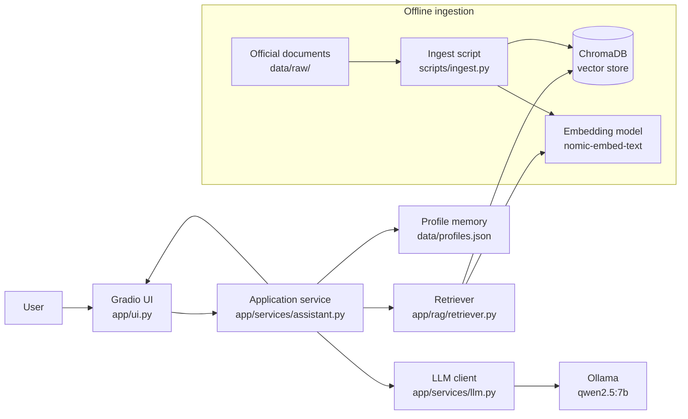

**Presentation video:**(https://drive.google.com/drive/folders/1gcJTnZM6jJ96IyynFetu01SYAJyXmXtM)
# Finland Bureaucracy Helper
An AI assistant that answers international students questions about Finnish bureaucracy (residence permits, DVV registration, Kela, tax card) using official documents, and shows the sources.

**Disclaimer:** This application provides general guidance only and is **not legal advice**. Always confirm with the official authority (Migri, DVV, Kela, Vero).


## 1. Team members

- Santosh Sigdel (santosh23000@student.hamk.fi, santosh.sigdel900@gmail.com)
- Puran karki (amk1002351@student.hamk.fi)
- Manoj Bhattarai (amk1006124@student.hamk.fi)
- Nabin Yari (amk1004480@student.hamk.fi)

## 2. Intended users and Problems 

### Intended users
International students, especially **non-EU students**, who are newly arrived or living in Finland and need to deal with Finnish authorities.
  
### Problem 
International students must complete many official processes, such as residence permits, address registration, Kela and tax cards. The information is spread across several government websites (Migri, DVV, Kela, Vero), International students must complete several official processes, often in a language they don't speak:

- Applying for and **extending a residence permit** (Migri)
- **Registering an address** and getting a **personal identity code** (DVV)
- Getting a **tax card** and understanding taxes when working (Vero)
- Understanding **Kela** benefits and eligibility
- Knowing **work-hour limits** for students

The information is **scattered across many official websites**, written in **long, formal language**, and often **depends on the student's situation** (EU or non-EU, permit type, length of stay). Students waste time, miss steps or rely on unreliable advice from social media groups.

### Main user need
"I want a quick, clear and **trustworthy** answer to my bureaucracy question that fits **my situation** and tells me **where the information comes from**.

## 3. Why AI is appropriate
- Students can ask questions in their own words. AI understands the meaning, not just keywords.
- AI summarises long official text into a short, clear answer.
- With RAG, answers come from official documents with sources, so the model doesn't make up rules.

## 4. Proposed solution and main workflow
### Main workflow
1. The user (optionally) sets a **profile**: citizenship group (EU/EEA or non-EU), status (degree student or exchange student), city.
2. The user asks a question, e.g. _"Can I work while studying and how many hours?"_
3. The application **retrieves** the most relevant passages from the official document collection.
4. The model generates a **short, plain-language answer** using **only** those passages and the user's profile.
5. The answer is shown with **source citations** (document name + link).
6. If the documents don't contain the answer, the assistant **says so** and points to the right authority instead of guessing.

### Example
```
Profile: Non-EU, degree student, Hämeenlinna
Q: Do I need to register my address with DVV?

A: Yes. If you live in Finland for more than one year, you should register
   your Finnish address and get a personal identity code at DVV...
   Sources: [DVV – Registering as a foreign resident]
```

## 5. Architecture


### components
| Component | File | Responsibility |
|---|---|---|
| UI (Gradio) | `app/ui.py` | Chat interface, profile settings, system status, answers with sources. Contains no AI logic. |
| Entry point | `app/main.py` | Connects all components and starts the app. |
| AI service | `src/services/ai_service.py` | Validate input → retrieve → build prompt → call model → check citations. |
| Retriever | `src/capabilities/rag/retriever.py` | Embeds the question and finds the top-k chunks above the similarity threshold (0.60). |
| Vector store | `src/capabilities/rag/store.py` | NumPy vector index with cosine similarity (`data/index`). |
| Chunking | `src/capabilities/rag/documents.py` | Loads the pages and splits them into chunks (900 characters, 150 overlap). |
| Download + cleaning | `scripts/fetch_sources.py` | Downloads the 33 official pages and removes menus, footers and cookie banners. |
| Index building | `scripts/ingest.py` | Creates embeddings for all chunks and saves the index. |
| Model client | `src/models/model_client.py` | Talks to Ollama (chat + embeddings) with timeouts, retry and clear error messages. |
| Profile memory | `src/capabilities/memory.py` | Saves the user's situation in `data/profile.json`. |
| Config | `src/config.py` | All settings in one place, read from `.env`. |

---

##  6. Additional AI capability and justification

### Primary: Retrieval-Augmented Generation (RAG)
**Why:** The main challenge is **finding and correctly using official information**. Rules about permits and benefits are specific and change over time. RAG:
- keeps answers **grounded** in official documents instead of the model's memory,
- lets us show **citations**, which builds trust and lets users verify,
- lets us **update knowledge** by re-running ingestion, without retraining a model.

### Secondary: Persistent user profile (memory)
**Why:** Many answers depend on the user's situation (e.g., EU citizens don't need a residence permit but must register their right of residence). Remembering the profile gives **more relevant answers** and avoids repeating the same content.

### Not used: agents / MCP
The workflow is always the same (retrieve → answer), so an agent that decides its own next step would add complexity and risk without real benefit. Live web access via MCP was not chosen because we want answers to come from a **controlled, verified** document set.

  ## 7. Model and runtime

| Purpose | Model | Runtime | Why |
|---|---|---|---|
| Answer generation | **`qwen2.5:7b`** | Ollama (local) | Good instruction-following (stays within context, cites sources), runs on a 16 GB laptop with partial GPU offload |
| Fallback / low-RAM | `llama3.2:3b` | Ollama (local) | Runs on 8 GB machines; selectable via `.env` |
| Embeddings | `nomic-embed-text` | Ollama (local) | Small (~300 MB), fast, good retrieval quality for English text |

**Why local inference?** It's free, needs no API keys, keeps user questions private (personal immigration situations are sensitive), and works offline after setup.

**Tested hardware:** AMD Ryzen 7 5800H, 16 GB RAM, NVIDIA GTX 1650 (4 GB).

## 8. Knowledge sources

Official, publicly available English-language guidance:

| Authority | Topics |
|---|---|
| **Migri** (Finnish Immigration Service), migri.fi | Student residence permits, extensions, working rights, EU registration |
| **DVV** (Digital and Population Data Services Agency), dvv.fi | Address registration, personal identity code |
| **Kela**, kela.fi | Eligibility for social security, health insurance card |
| **Vero** (Finnish Tax Administration), vero.fi | Tax card, taxation of student work |
| **InfoFinland**, infofinland.fi | General guidance for newcomers |
| **HAMK** international student pages | Arrival checklist, local practicalities |

The date each document was collected is stored in its metadata. See `data/sources.md` for the full list.
## 9. Project structure

```
.
├── app/
│   ├── main.py                    # Entry point: wires components, starts Gradio
│   └── ui.py                      # Gradio interface (talks only to the AI service)
├── src/
│   ├── config.py                  # Settings from .env
│   ├── models/model_client.py     # Ollama client (chat + embeddings), error handling
│   ├── schemas/responses.py       # Structured answer (AIResponse, Source)
│   ├── services/ai_service.py     # Main logic: validate → retrieve → prompt → check
│   └── capabilities/
│       ├── memory.py              # User profile memory
│       └── rag/
│           ├── documents.py       # Loading + chunking
│           ├── store.py           # NumPy vector store
│           ├── retriever.py       # Top-k search with similarity threshold
│           └── ingest.py          # Builds the index
├── scripts/
│   ├── fetch_sources.py           # Downloads + cleans the 33 official pages
│   └── ingest.py                  # Builds the search index
├── data/
│   ├── sources.json               # List of official pages
│   └── raw/                       # Downloaded pages
├── evaluation/
│   ├── test_cases.json            # 29 evaluation cases
│   ├── run_eval.py                # Runs the evaluation
│   └── evaluation_results.md      # Results
├── tests/                         # 37 unit tests
├── docs/
│   ├── architecture.md
│   └── project-decisions.md
├── .env.example
├── environment.yml
└── requirements.txt
```

_(Adapt folder names to the starter template's structure.)_


## 10. Setup and execution

### Prerequisites
- Python 3.10 or newer
- [Ollama](https://ollama.com/download) installed and running
- About 6 GB of free disk space for the models

### 1. Clone the repository
```bash
git clone https://github.com/Santosh0423/AI_application_project.git
cd AI_application_project
```

### 2. Install dependencies
**Option A: venv**
```bash
python -m venv .venv
.venv\Scripts\activate          # Windows
source .venv/bin/activate       # macOS / Linux
pip install -r requirements.txt
```

**Option B: Conda**
```bash
conda env create -f environment.yml
conda activate dev-ai-project
```

### 3. Download the models
```bash
ollama pull qwen2.5:7b
ollama pull nomic-embed-text
```

### 4. Configure (optional)
```bash
copy .env.example .env          # Windows
cp .env.example .env            # macOS / Linux
```
Then edit `.env` if needed:
```
OLLAMA_BASE_URL=http://localhost:11434
MODEL_NAME=qwen2.5:7b
EMBED_MODEL=nomic-embed-text
CHUNK_SIZE=900
CHUNK_OVERLAP=150
TOP_K=4
MIN_SIMILARITY=0.60
REQUEST_TIMEOUT=300
```
The app also works without a `.env` file (these are the defaults). For a laptop with 8 GB RAM, use `MODEL_NAME=llama3.2:3b`. No API keys are required. **Never commit `.env`.**

### 5. Build the knowledge base
The 33 official pages are already in `data/raw/`. Build the search index (about 1–2 minutes):
```bash
python scripts/ingest.py
```
Optional: download fresh copies of the pages first with `python scripts/fetch_sources.py`.

### 6. Run the application
```bash
python -m app.main
```
Open **http://127.0.0.1:7860** in your browser. The **System status** panel shows whether Ollama and the knowledge base are ready.

### 7. Run tests and evaluation
```bash
python -m pytest                    # 37 unit tests, no Ollama needed
python evaluation/run_eval.py       # 29 evaluation cases, needs Ollama + index
```
## 11. Reliability and failure handling

| Situation | Behaviour |
|---|---|
| Ollama not running / model missing | Clear message: _"The AI model is unavailable. Please start Ollama."_ No crash. |
| Model timeout | Request is cancelled after `REQUEST_TIMEOUT`; user sees a retry message |
| Empty or too-long question | Input validation before calling the model |
| Question not covered by documents | The assistant says it cannot find the information and suggests the relevant authority |
| Off-topic question (e.g. weather) | Politely declines; explains the assistant's scope |
| Retrieval returns low-relevance chunks | A similarity threshold prevents answering from irrelevant text |
| Answer without citation | Output is checked; sources are always attached from retrieval metadata |
| Vector database missing | App tells the user to run `scripts/ingest.py` |
| Possibly outdated information | Every answer shows the disclaimer and links to the official page |

## 12. Evaluation


### Approach
`evaluation/test_cases.json` contains **29 cases**:

| Category | Cases | Examples | What we check |
|---|---|---|---|
| Successful cases | 17 | "Can I work while studying? How many hours?" | Answered, correct source cited, key fact present (e.g. 30 h/week, €800/month, 45 credits) |
| Difficult cases | 4 | Same question for EU vs non-EU profile; follow-up "What about during holidays?" | Answer fits the profile / uses the previous question |
| Failure cases | 8 | "What is the capital of France?", bus ticket prices, empty input | Refuses or rejects instead of guessing |

Run it with:
```
python evaluation/run_eval.py
```
It asks every question through the same AI service as the app and writes `evaluation/evaluation_results.md`.

### Results

| Metric | Result |
|---|---|
| Pass rate (all 29 cases) | __ / 29 |
| Retrieval hit (expected source found) | __ / 19 |
| Expected source cited in answer | __ / 19 |
| Key facts present in answer | __ / 19 |
| Correct refusals (not covered + off-topic) | __ / 6 |
| Invalid input rejected | __ / 2 |
| Average response time | __ s |

**Unit tests:** 37 tests (`pytest`), all passing.


## 13. Limitations

- **Not legal advice.** The assistant can be wrong or incomplete.
- **Static knowledge.** Documents are collected on a specific date; rules may change. Re-run ingestion to update.
- **English only.** Finnish and Swedish sources are not included.
- **Limited scope.** It covers common student processes only, not every immigration case (e.g. family ties, asylum).
- **Local model limits.** Smaller models may sometimes misread or oversimplify complex rules.
- **Single user.** The profile is stored locally; there are no user accounts.

---

