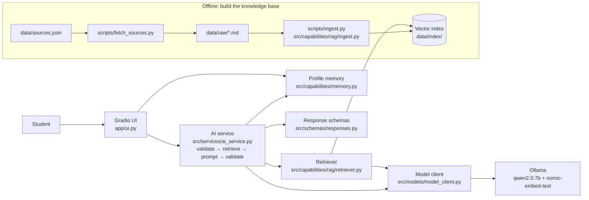
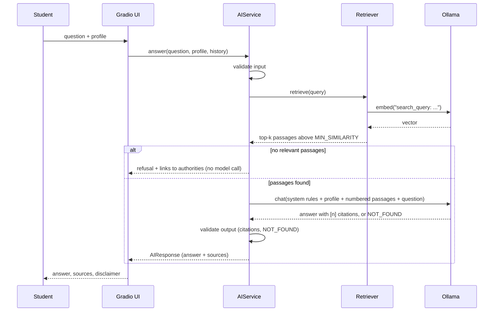

# Architecture

## Components

The template's core rule is kept: **the UI never talks to Ollama or the model client directly.** Everything goes through `AIService`.

| Layer | Files | Responsibility |
|---|---|---|
| Presentation | `app/ui.py`, `app/main.py` | Chat, profile form, system status; `main.py` wires the components together |
| Service | `src/services/ai_service.py` | Input validation, retrieval, prompt building, output validation, error handling |
| Schemas | `src/schemas/responses.py` | Pydantic `AIResponse` and `Source`: validated, structured output |
| Model access | `src/models/model_client.py` | The only code that talks to Ollama: chat + embeddings, timeouts, retry, typed errors |
| Capability: RAG | `src/capabilities/rag/` | Load and chunk documents, vector store, top-k retrieval, index building |
| Capability: memory | `src/capabilities/memory.py` | Persistent user profile with value validation |
| Config | `src/config.py`, `.env` | All settings in one place |

## Request flow (one question)

## Offline ingestion
1. `scripts/fetch_sources.py` downloads each URL in `data/sources.json`, keeps the main content (headings, paragraphs, lists), removes menus, footers and cookie banners, and saves `data/raw/<authority>-<title>.md` with a header holding the title, URL, authority and date.
2. `scripts/ingest.py` splits each document into chunks of about 900 characters (paragraph-aware, 150-character overlap), embeds them with `nomic-embed-text` (title + text, `search_document:` prefix), and saves `data/index/vectors.npy` plus `chunks.json`.

## Testability
`AIService` depends on *protocols* (anything with `retrieve()` / `chat()`), so the unit tests use fakes and run without Ollama.
